

<a href="https://www.ranggaocstar.web.id/"></a>

 

 

I work on three parts of a business that usually run separately: **search, websites, and sales follow-up.** A good website gets someone to ask a question. A good sales workflow makes sure the next person knows what to do with it.

My background is marketing, not software engineering. I decide what a tool needs to do, AI agents write the code, and I test the result against the real workflow it is meant to improve.

 

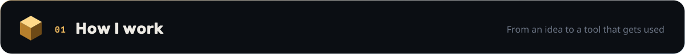


 

  <a href="https://github.com/ranggaoscar/rockbase"></a>
  <a href="https://github.com/ranggaoscar/rockfoundry"></a>
  <a href="https://github.com/ranggaoscar/hermes-salespilot"></a>
  <a href="https://github.com/ranggaoscar/ideacut"></a>
  <a href="https://github.com/ranggaoscar/kanvas-studio"></a>

 

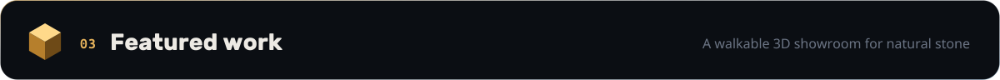

  

  &nbsp;
  <strong>Magrade Virtual Showroom</strong>: walk through a 3D room and compare natural stone at real scale, right in the browser. 
  <a href="https://magrade.co.id/showroom/"><strong>Explore the showroom →</strong></a> &nbsp;·&nbsp; <a href="https://www.ranggaocstar.web.id/projects/magrade">Read the case study</a>

 

<table>
  <tr>
    <td width="33%" valign="top">
       
      <a href="https://bresciahub.id/"><strong>Brescia Hub</strong></a> 
      A public stone gallery. Browse real slabs and compare materials in different rooms.
    </td>
    <td width="33%" valign="top">
       
      <a href="https://www.bresciastonebali.com/"><strong>Brescia Stone Bali</strong></a> 
      Stone collection and project portfolio for villas, resorts, and interiors in Bali.
    </td>
    <td width="33%" valign="top">
       
      <a href="https://bresciastone.com/"><strong>Brescia Stone</strong></a> 
      The main brand site: cinematic intro, searchable stone collection, and a 3D showroom.
    </td>
  </tr>
</table>

 

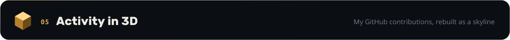

  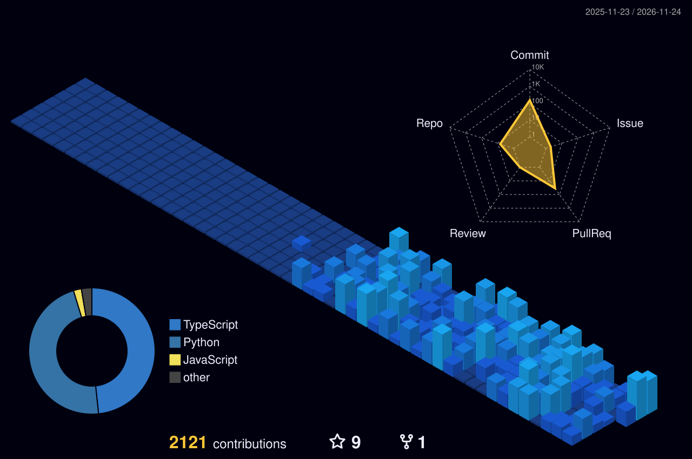

 

<a href="https://www.ranggaocstar.web.id/">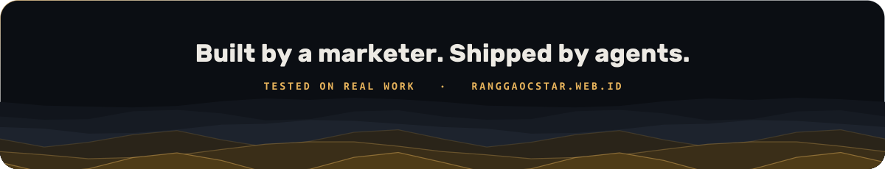</a>

